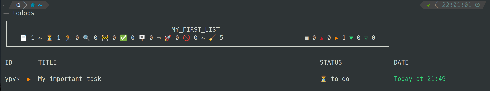
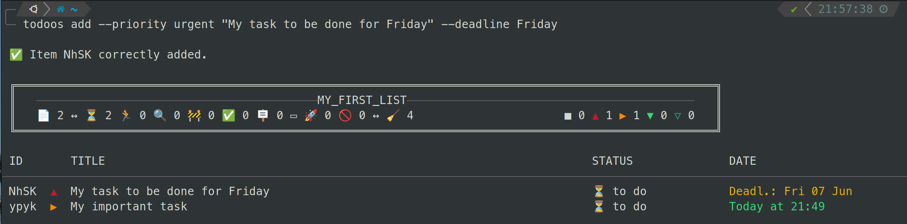

# ToDoOs

Smart CLI task manager with priorities, deadlines, multi-list support, and ZSH autocompletion.




Tested on Linux with ZSH and Oh My ZSH. A monospace font (Meslo, Ubuntu Mono) is recommended. Open an issue for bugs or suggestions.

---

# Installation

## Pre-requisites

- CMake (>3.28)
- Ninja or gcc (& build-essential)
- ZSH (recommended)
- noto-fonts-emoji

## Build & install

```bash
git clone https://github.com/oceanspy/todoos.git
cd todoos
make
sudo make install
```

## ZSH autocompletion

```bash
make omz-install && omz reload
```

## ZSH aliases & shortcuts

Copy the aliases file and load it from your `.zshrc`:

```bash
cp Linux/Zsh/zsh_todoos_aliases ~/.zsh_todoos_aliases
```

```zsh
# ~/.zshrc
source ~/.zsh_todoos_aliases
```

Then reload: `source ~/.zshrc && omz reload`

If you use the Unison sync setup, use `zsh_todoos_sync` instead — it wraps the aliases and syncs files on every todoos call.

## First launch & configuration

First launch creates the required directories and files.

- Lists are stored in `~/.todoos/`
- Config is stored in `~/.oceanspy/todoos/config.conf`

---

# Basic usage

```bash
# Show the active list
todoos

# Add an item
todoos add "My new task"

# Add with priority
todoos add -p high "Urgent refactor"

# Edit an item
todoos edit ab12 "Updated text"

# Find items
todoos find "keyword"

# Set a deadline
todoos deadline today ab12
todoos deadline 2026-08-01 ab12 cd34

# Add a detailed description (opens $EDITOR)
todoos describe ab12

# Show stats
todoos stats
```

## Status workflow

```bash
todoos start ab12      # → Started
todoos pause ab12      # → Paused
todoos complete ab12   # → Completed
todoos cancel ab12     # → Cancelled
```

## List management

```bash
todoos list                        # Show all lists
todoos list add "work"             # Create a list
todoos use "work"                  # Switch to it
todoos move-to "work" ab12 cd34   # Move items across lists
todoos copy-to "work" ab12        # Copy items across lists
```

## Archive & clean

```bash
todoos clean          # Archive all completed/cancelled items
todoos --archived     # View the archive
todoos restore ab12   # Restore an archived/deleted item
```

---

# Command reference

```
todoos [flags] [options] <command> [args]
```

## Flags

| Flag | Description | Applies to |
|------|-------------|------------|
| `-h/--help` | Show help | |
| `-v/--version` | Show version | |
| `-c/--config` | Show config | |
| `-A/--archived` | Target archive | `show`, `find` |
| `-D/--deleted` | Target deleted items | `show`, `find` |
| `-d/--described` | Filter/include items with descriptions | `add`, `show`, `find`, `clean` |
| `-f/--force` | Skip confirmation | `remove`, `move-to`, `copy-to` |
| `-Q/--no-quit` | Keep app alive after command | |

## Options

| Option | Description |
|--------|-------------|
| `-l/--list {name}` | Target a specific list |
| `-p/--priority {name}` | Filter or set priority |
| `-s/--status {name}` | Filter or set status |
| `-i/--deadline {date}` | Filter or set deadline |

## Lists

| Command | Description |
|---------|-------------|
| `use {list}` | Switch active list |
| `list` | Show all lists |
| `list add {name}` | Create a list |
| `list rm {name}` | Remove a list |
| `list mv {name} {new_name}` | Rename a list |
| `list copy {name} {new_name}` | Duplicate a list |
| `list current` | Show the active list |

## Items

| Command | Description |
|---------|-------------|
| `show` | Show items (`-p`, `-s`, `-i`, `-A`, `-d`, `-D`) |
| `add (a) {value}` | Add item (`-p`, `-s`, `-i`, `-d`) |
| `edit (e) {id} {value}` | Edit item (`-p`, `-s`, `-i`) |
| `append {id} {value}` | Append text to item |
| `prepend {id} {value}` | Prepend text to item |
| `find (f) {word}` | Search items (`-A`, `-d`, `-D`) |
| `describe (d) {id}` | Edit item description in `$EDITOR` |

## Item actions

| Command | Description |
|---------|-------------|
| `remove (rm) [-f] {ids}` | Remove items |
| `duplicate {ids}` | Duplicate items |
| `archive {ids}` | Send to archive |
| `restore {ids}` | Restore archived or deleted items |

## Transfer

| Command | Description |
|---------|-------------|
| `move-to (mv) {list} {ids}` | Move items to another list |
| `copy-to (cp) {list} {ids}` | Copy items to another list |

## Priority

| Command | Description |
|---------|-------------|
| `priority (p) {priority} {ids}` | Set priority |
| `increase (inc) [1-4] {ids}` | Raise priority |
| `decrease (dec) [1-4] {ids}` | Lower priority |

Priority levels: `low` · `medium` · `high` · `urgent` · `critical`

## Deadline

```bash
todoos deadline {date} {ids}
```

Accepted formats:
- Absolute: `YYYY-MM-DD`, `MM-DD`, `DD`
- Keywords: `today`, `tomorrow`, `next-week`, `next-month`, `next-year`
- Relative: `1d`, `1w`, `1m`, `1y`, `Xday(s)`, `Xweek(s)`, `Xmonth(s)`, `Xyear(s)`
- Remove: `reset` or `none`

## Status

| Command | Result |
|---------|--------|
| `queue {ids}` | → Queued |
| `start {ids}` | → Started |
| `triage {ids}` | → Triaged |
| `pause {ids}` | → Paused |
| `block {ids}` | → Blocked |
| `complete {ids}` | → Completed |
| `cancel {ids}` | → Cancelled |
| `reset {ids\|all}` | → Queued, clears deadline |

## Bulk

| Command | Description |
|---------|-------------|
| `clean` | Archive all completed/cancelled items (`-d` to include described items) |
| `empty` | Empty the list |

## Built-in shortcuts

| Shortcut | Expands to |
|----------|------------|
| `create` | `add` |
| `up` / `upper` | `increase` |
| `low` / `lower` | `decrease` |
| `current` | `list current` |
| `all` | `show` (all items) |
| `done` | `complete` |
| `dln` | `deadline` |
| `desc` | `describe` |
| `search` / `s` | `find` |

> Item IDs are 4-character identifiers. Multiple IDs are space-separated: `ab12 cd34 ef56`

---

# ZSH aliases

After installing `zsh_todoos_aliases`:

| Alias | Command |
|-------|---------|
| `t` | `todoos` |
| `tu` | `todoos use` |
| `ta` | `todoos add` |
| `tau` | `todoos add -p urgent` |
| `tah` | `todoos add -p high` |
| `tam` | `todoos add -p medium` |
| `tal` | `todoos add -p low` |
| `tac` | `todoos add -p critical` |
| `td` | `todoos -l default` |
| `tdau` | `todoos -l default add -p urgent` |
| `tdah` | `todoos -l default add -p high` |
| `tdam` | `todoos -l default add -p medium` |
| `tdal` | `todoos -l default add -p low` |
| `tdac` | `todoos -l default add -p critical` |

---

# Configuration

`~/.oceanspy/todoos/config.conf`:

```bash
# Storage path for list files (default: ~/.todoos/)
appDirStorage:

# Storage format: csv | json  (recommended: csv)
fileDataStorageType: csv

# Default list name
defaultList: default

# Theme: default | legacy
theme: default

# Max row width in chars (0 = use terminal width)
consoleRowMaxLength: 0

# Auto-archive items when completed/cancelled: true | false
archiveWhenCompleted: false

# ID generation style: letters-lowercase | letters | random
idRandomGenerationType: letters-lowercase
```

---

# Sync

To sync lists across devices on Linux, a Unison configuration is available in the `Linux/` directory. See `Linux/sync/unison.md` for setup instructions.
